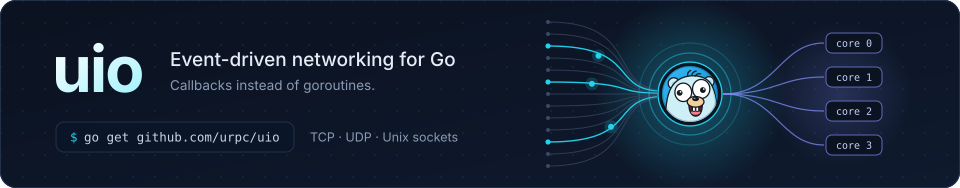
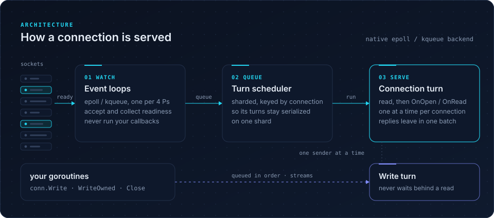
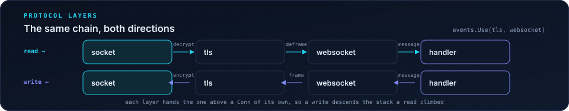

<p align="center">
  
</p>

<p align="center">
  <a href="https://pkg.go.dev/github.com/urpc/uio"></a>
  <a href="https://github.com/urpc/uio/actions/workflows/ci.yml"></a>
  <a href="LICENSE"></a>
</p>

**uio** is an event-driven networking library for Go. You write a few
callbacks; uio watches the sockets, runs your code when a connection has
something to say, and sends your replies in as few system calls as it can —
without a goroutine per connection.

## Highlights

- **Callbacks, not goroutines.** `OnOpen`, `OnData` and `OnClose` run in order
  for each connection and never overlap, so the state they share needs no
  locks, and on epoll/kqueue an idle connection is a small struct rather than
  a parked goroutine.
- **A slow handler stalls nothing else.** On epoll/kqueue, event loops only
  collect readiness; callbacks run on a worker pool, and work stuck behind a
  blocked callback is handed to another worker within milliseconds.
- **Write from anywhere.** `Write`, `WriteOwned` and `Close` are safe from any
  goroutine; bytes leave in the order they were written.
- **Zero-copy where it counts.** Decode packets straight from the read buffer,
  encode replies straight into the send queue, and send a round of replies
  together, usually in one `writev`.
- **Built-in backpressure.** Per-connection limits on buffered input and
  output: input past its limit pauses reads, so TCP flow control slows a
  flooding peer, and output past its limit fails the write instead of growing
  memory without bound.
- **Cross-platform.** epoll on Linux, kqueue on macOS and the BSDs, and a
  portable goroutine-per-connection backend on Windows (or anywhere with
  `-tags stdio`).
- **TCP, UDP and Unix sockets**, listening and dialing, IPv4 and IPv6.

## Install

```bash
go get github.com/urpc/uio
```

uio needs Go 1.25 or newer.

## Quick start

An echo server:

```go
package main

import (
	"log"

	"github.com/urpc/uio"
)

func main() {
	events := &uio.Events{
		Handler: uio.FuncHandler{
			Open: func(c uio.Conn) {
				log.Println("hello", c.RemoteAddr())
			},
			Data: func(c uio.Conn) error {
				_, err := c.WriteTo(c) // echo everything that arrived
				return err
			},
			Close: func(c uio.Conn, err error) {
				log.Println("bye", c.RemoteAddr(), err)
			},
		},
	}

	log.Fatal(events.Serve(":9527"))
}
```

`Serve` accepts several addresses at once, with an optional scheme:
`":9527"`, `"tcp6://[::1]:9527"`, `"udp://:5353"`, `"unix:///tmp/app.sock"`.
Once `Serve` is running (`Serve()` with no address for a dial-only client),
the same `Events` can dial out with `Dial` or `DialContext`, take over an
established stream `net.Conn` with `Adopt`, or add an address with
`Listen(addr, userdata)`. Each connection a listener accepts starts with its
userdata, and closing the returned `Listener` stops accepting there while the
connections it accepted stay open (a UDP listener's peers share its socket and
close with it). A packet listener also dials: assert the returned
`Listener` to a `PacketListener` and `DialPeer(raddr, userdata)` makes the
peer's connection on the listener's own socket — what it sends leaves from
the listener's address and the peer's answers reach that connection, as they
would had the peer spoken first — which is the entry point for hole punching;
`WriteTo` sends a single datagram the same way.

For the socket options no setter carries, `Conn.Control(fn)` runs fn with the
connection's descriptor — IP_TTL for a NAT probe, IP_TOS, SO_MARK — and the
`SocketControl` options run before a socket connects or binds:
`WithDialControl` on a dial, `WithLocalAddr` binds the dial's socket first,
and `WithListenControl` runs on a `Listen`'s socket before it binds. `fd` is
valid only for the call, and these are the hooks a hole punch needs; the
punching itself is yours.

## How it works

<p align="center">
  
</p>

1. **Watch.** A few event loops — epoll or kqueue instances, one per four Ps
   by default — accept connections and collect readiness. They never run your
   code.
2. **Queue.** A ready connection is handed to a sharded worker pool. Its turns
   go to the shard its key picks — the pool adds shards as connections grow —
   so its work tends to return to the same CPU, where its socket is still warm
   in cache. You can supply your own scheduler through `Events.Executor`.
3. **Serve.** A connection's *turn* reads the socket, runs `OnData`, and then
   flushes every reply the callback wrote in one go. Turns of one connection
   never overlap; different connections run in parallel.

A write from another goroutine — say, an RPC reply that finishes later — is
queued and sent by a short *write turn*, so it does not wait for a slow read.
Only one sender touches a socket at a time, and bytes leave in the order they
were written.

**Timed turns.** `SetWakeDeadline` schedules an `OnData` for a connection at
a time of your choosing, within one scheduler tick of it — the timed form of
`Wake`, for heartbeats, protocol update ticks and idle timeouts;
`SetWakeInterval` repeats. The turn carries
no data and no reason: it may run early for another wake and may find bytes
already buffered, so a callback checks its own clocks every time it runs. On
the native backend the timers live on a per-loop timing wheel that a kernel
timer wakes, so an armed timer costs no goroutine and an idle connection
none at all; the `stdio` backend runs one runtime timer per armed
connection.

This describes the native epoll/kqueue backend. The portable `stdio` backend
used on Windows (or with `-tags stdio`) gives each stream connection its own
reader and writer goroutines instead.

## Protocol layers

A protocol that is not yours to implement — TLS, compression, an auth
handshake — can sit between the socket and your handler as a protocol layer.
`Events.Use` stacks layers under `Events.Handler`; the first one installed sits
nearest the wire.

A wss server is the smallest complete example: a TLS layer, a WebSocket
package, and one line joining them. The two directions run through the same
stack and mirror each other exactly.

Reading, left to right: the socket hands up TLS records, the TLS layer
decrypts them into a plaintext stream, the WebSocket protocol deframes that
stream into messages, and your handler sees payloads.

Writing, right to left: `SendText` becomes a frame, the frame is encrypted
into a TLS record, and the record leaves by the same socket.

<p align="center">
  
</p>

A layer transforms bytes, and UIO carries everything else. Writing one means
writing what the protocol changes — nothing more:

```go
type Layer interface {
	Attach(ctx LayerContext) LayerConn // once per connection
}

type LayerConn interface {
	OnOpen(ctx LayerContext)                            // start a handshake; ctx.Open() when settled
	OnInbound(ctx LayerContext) error                   // bytes from below → ctx.Deliver(...)
	OnOutbound(ctx LayerContext, p []byte) (int, error) // bytes from above → ctx.Write(...)
	OnTimer(ctx LayerContext) error                     // this layer's own timer came due
	OnClose(ctx LayerContext, cause error)
}
```

`Layer` is the protocol, configured once; `LayerConn` is its instance on one
connection; `LayerContext` is that instance's place in the stack — what lies
below it, and what it hands up. An obfuscation layer is all of this:

```go
type xorConn struct {
	uio.PassThrough // open at once, pass through what is not overridden
	key byte
}

func (x *xorConn) OnInbound(ctx uio.LayerContext) error {
	in := ctx.Lower().PeekChunk()
	ctx.Deliver(xor(in, x.key))
	_, err := ctx.Lower().Discard(len(in))
	return err
}

func (x *xorConn) OnOutbound(ctx uio.LayerContext, p []byte) (int, error) {
	if _, err := ctx.Write(xor(p, x.key)); err != nil {
		return 0, err
	}
	return len(p), nil
}

events.Use(uio.LayerFunc(func(uio.LayerContext) uio.LayerConn { return &xorConn{key: 0x5a} }))
```

[`examples/xorlayer`](examples/xorlayer) runs this layer for real, on both
ends of one connection, under a second layer that prints the bytes on the
wire: `go run ./xorlayer` in `examples` shows a message leave as plaintext,
cross the wire XOR'd, and arrive as plaintext again.

The layer above — the next layer or your Handler — gets a `Conn` UIO builds
over this one: its reads are what the layer delivered, its writes reach
`OnOutbound`, and its addresses, userdata, deadlines and socket options are the
connection's own. A layer writes none of that.

### Two paths through one stack

Installed with `events.Use(utls.Server(cfg), tracing)`, what arrives climbs
them in install order and what you write walks back down:

```
read    socket → [decrypt] → [trace] → Handler.OnData
write   socket ← [encrypt] ← [trace] ← conn.Write in the Handler
```

### What UIO guarantees every layer

These are UIO's to keep, not each layer's to remember:

1. **Every turn reaches the layers above**, whether or not a layer delivered
   anything. A wake, or a timer armed higher up, reaches the Handler through
   any stack — a layer cannot swallow it.
2. **Every layer has a timer of its own.** `LayerContext.SetTimer` arms the
   layer's, and the Handler's `SetWakeDeadline` is a slot of its own too: no
   layer replaces another's.
3. **The turn callbacks never overlap.** `OnOpen`, `OnInbound`, `OnTimer`,
   `OnSent`, `OnClose` and the Handler's callbacks run on the connection's
   turns. The others run where they are called for and may overlap the
   turns: `OnOutbound` on the writer's goroutine, `CloseGracefully` and
   `CloseWrite` on the closing goroutine, `OutboundHeld` on writers' and
   `Flush` on a turn's or the caller of `Flush`. State they share needs a
   lock. UIO never calls a layer from below or from inside another layer's
   callback, so a layer may hold its lock while it writes, flushes or closes
   below.
4. **A connection ends once, top down.** The Handler's `OnClose` comes first,
   if its `OnOpen` ran, then every layer's. A connection whose stack never
   opened — a failed handshake — ends without a Handler callback. Once a
   close has begun — from the Handler or from any layer, even inside its
   `OnSent` or `Flush` — no new call reaches a layer: writes, flushes and
   closes return `net.ErrClosed`, and only `OnClose` follows.
5. **The end of a stream travels up.** A layer whose peer ended its stream
   calls `LayerContext.End`; the layer above reads `io.EOF` after the rest.
   At the top it closes the connection, or, with `AllowHalfOpen`, leaves the
   Handler to end its own half with `CloseWrite`.
6. **`MaxOutboundBuffered` refuses whole writes, at the top.** The Handler's
   write is checked against the queue below it before it enters the stack,
   and reserves its room, so concurrent writers cannot pass the limit
   together; what a layer writes below is never refused — a TLS record, once
   encrypted, has to reach the wire.
7. **A graceful close lets the queue leave first.** `Close` on a layered
   connection closes the socket once what was queued — the layers' goodbyes
   included — has left, or once it stopped moving for `uio.LingerTimeout`;
   what arrives meanwhile is discarded. A `CloseWith` with any other error
   aborts at once.
8. **`MaxInboundBuffered` covers the whole stack.** Bytes the layers hold for
   the Handler count against it with the socket's buffer: a stack holding the
   limit takes nothing more from the socket until the Handler reads.
9. **Layers carry streams.** An Events with layers refuses UDP, IP, unixgram
   and unixpacket connections with `ErrLayersNeedStream`.

A layer carries one connection: one above for each one below. A protocol that
opens several streams over one connection — HTTP/2, QUIC — is the Handler's to
model, over a connection the layer below it made.

### Dials and adopted connections run the same stack

`DialContext` returns only once the whole stack has opened, and the `Conn` it
returns is the top layer's — encrypted underneath, plaintext to you. `Adopt`
and `AdoptContext` do the same for a `net.Conn` you hand over:

```go
client := &uio.Events{}
client.Use(utls.Client(cfg))
conn, err := client.DialContext(ctx, "tcp://example.org:443", nil)
// conn reads and writes plaintext; utls encrypts below it
```

A layer that fails before the stack opens reports its error from
`DialContext`, and the Handler hears nothing of the connection — no `OnOpen`,
no `OnClose`. What a layer negotiated is its own to report:
`uio.FindLayer[T](conn)` returns the first layer of type `T` below `conn` —
`uio.FindLayer[interface{ State() tls.ConnectionState }](conn)` finds the TLS
state under any stack — and `uio.LayerOf(conn)` the one that built `conn`.

A `LayerConn` may also implement optional interfaces:

- `CloseWriter` ends one direction in its own protocol (a TLS close_notify).
  A layer without it does not support `CloseWrite`; `PassThrough` passes it
  down. UIO calls it only after what was written before `CloseWrite` has
  gone below: writes in flight finished, the layer flushed, held output
  sent.
- `GracefulCloser` says goodbye as the layer above closes, told the close's
  cause.
- `SendObserver` hears every byte the socket sends, on the connection's
  turn — for a protocol whose state moves as its output leaves, a ping's
  timeout or a close waiting for its frame.
- `OutboundHolder` and `Flusher` are for a layer that holds output of its own,
  a send window or a compressor's buffer: what it holds counts as queued, and
  `Flush` reaches it.

### What it is not

- **Not request middleware.** A layer runs once per connection and transforms
  its byte stream; it never sees a request or a message. Per-message work
  belongs in `OnData`.
- **`Observer` and `Hooks` do not run through layers.** They count the bytes on
  the wire, which is what makes them right for traffic accounting; the
  connection they are told about is the one your Handler holds. They only
  observe: `OnOutbound` may run inside a layer's write, so it must not write
  to or close the connection.
- **`Use` before `Serve`.** `Serve` reads the layers once; a `Use` after it
  installs nothing.

## Configuration

Everything is optional; the zero `Events` is ready to use.

| Field | Default | What it does |
| --- | --- | --- |
| `Pollers` | one per 4 Ps: 1–8 native, at least 2 on stdio | Number of event loops, never more than `GOMAXPROCS`. |
| `Executor` | built-in sharded pool | Your own scheduler for connection and write turns (native backend). |
| `MaxBufferSize` | 4 KiB | Bytes read per socket read. |
| `WriteBufferedThreshold` | off | Native backend: callback writes smaller than this are queued for the end of the turn instead of sent at once. Replies written in `OnData` are batched either way. |
| `MaxOutboundBuffered` | off | Per-connection limit on unsent bytes; a write past it returns `ErrOutboundOverflow`. |
| `MaxInboundBuffered` | off | Per-connection limit on read but not yet consumed bytes. Once callbacks leave this much unconsumed, the connection stops reading its socket and TCP flow control slows the peer; a `Wake` whose `OnData` consumes below the limit reads on. A `ReserveInbound` larger than the limit returns `ErrInboundOverflow`. |
| `AllowHalfOpen` | off | Keeps a stream connection open after the peer shuts its writing half: `OnData` runs once more, `Read` reports `io.EOF` once the buffered bytes are consumed, and the connection can still write until `CloseWrite` shuts this side's half too; it closes once both halves are shut and the bytes the peer sent have been consumed. |
| `ReusePort` | off | Sets `SO_REUSEPORT` on listeners. |
| `LockOSThread` | off | Locks each event-loop goroutine to its own OS thread; callback workers are unaffected. |

The callbacks are three interfaces, each its own field of `Events`:

| Field | Interface | Methods |
|---|---|---|
| `Handler` | `Handler` | `OnOpen`, `OnData`, `OnClose`: every connection's lifecycle and data |
| `Observer` | `TrafficObserver` | `OnInbound`, `OnOutbound`: bytes read and written |
| `Hooks` | `ServeHooks` | `OnStart`, `OnStop`: around `Serve` |

Any type implementing an interface fits its field. `FuncHandler` adapts plain
functions to all three: set it as whichever fields its functions fill, and
leave the rest unset. An unset field, or a nil `FuncHandler` function, costs
nothing; the three are read once, when `Serve` starts.

## Backpressure

`MaxInboundBuffered` alone does not slow a peer: it acts when a callback
returns without consuming, and the bytes left behind grow the inbound buffer.
So when a connection's data goes somewhere slower — a relay leg, an upstream
call, another peer — stop consuming once that destination is behind, and wake
the source when it drains:

```go
relay := uio.FuncHandler{
	Data: func(c uio.Conn) error {
		peer := peerOf(c) // the paired connection, e.g. from Userdata
		if peer.OutboundBuffered() >= 256<<10 {
			return nil // the far side is behind: leave the bytes unconsumed
		}
		_, err := c.WriteTo(peer)
		return err
	},
	Outbound: func(c uio.Conn, _ int) {
		if c.OutboundBuffered() < 128<<10 {
			_ = peerOf(c).Wake() // the far side drained: resume its held reads
		}
	},
}
events := &uio.Events{MaxInboundBuffered: 256 << 10, Handler: relay, Observer: relay}
```

Once the unconsumed bytes reach the limit, that connection stops reading and
TCP flow control blocks whoever is feeding it, so memory stays bounded without
closing anyone. Reads resume by themselves as soon as a callback consumes below
the limit; but while they are held no I/O event arrives to run that callback,
so it takes a `Wake` — it carries no data — to trigger it. A handler that
always consumes its inbound never reaches the hold and needs none. A write past
the destination's own `MaxOutboundBuffered` would fail with
`ErrOutboundOverflow` instead — the check above stays below it, so a full queue
pauses the source rather than erroring.

## Going faster

These are optional. Plain `Read`, `Write` and `WriteTo` work on every backend.

**Decode in place.** `PeekChunk` returns the first chunk of buffered bytes
without copying.
For a length-prefixed protocol, `ReserveInbound` gathers a packet that spans
several reads into one chunk, so it can still be decoded in place:

```go
func onData(c uio.Conn) error { // a Handler's OnData, or a FuncHandler's Data
	var header [4]byte
	for {
		h := c.Peek(header[:]) // copies only if the header spans reads
		if len(h) < 4 {
			return nil // wait for the header
		}
		size := binary.BigEndian.Uint32(h)
		if size > maxPacket {
			return errTooBig // check before reserving: it allocates
		}
		total := 4 + int(size)
		if err := c.ReserveInbound(total); err != nil {
			return err
		}
		chunk := c.PeekChunk()
		if len(chunk) < total {
			return nil // the rest is on its way
		}
		handle(chunk[4:total])
		c.Discard(total)
	}
}
```

**Encode in place.** Inside a stream connection's own callback on the native
backend, `ReserveOutbound` hands you room in the send queue to encode a reply
into. Anywhere else it returns an error; encode into a pooled buffer and give
it away with `WriteOwned` instead:

```go
if dst, err := c.ReserveOutbound(n); err == nil {
	encode(dst) // fill every byte before the callback returns or flushes
} else {
	buf := uio.AcquireBuffer(n)
	encode(buf.AvailableBuffer()[:n])
	buf.CommitWrite(n)
	if _, err := c.WriteOwned(buf); err == uio.ErrOutboundOverflow {
		uio.ReleaseBuffer(buf) // overflow is the only error that hands it back
	}
}
```

## Rules of the road

- The inbound methods — `Read`, `WriteTo`, `Peek`, `PeekChunk`, `Discard`,
  `InboundBuffered` and `ReserveInbound` — may only be called inside the
  connection's own callback. Slices they return are valid until the callback
  returns or consumes more input; copy anything you hand to another goroutine.
  Builds with `-race` catch most misuse with a panic.
- `Write`, `Writev`, `WriteString`, `WriteOwned`, `Flush`, `Close`, `CloseWrite`
  and `CloseWith` are safe from any goroutine.
- `CloseWrite` shuts a stream connection's writing half after everything
  accepted has been sent; later writes return `net.ErrClosed`. On a layered
  connection it runs the layer's own `CloseWrite` inline — flushing it, and
  writing a TLS close_notify — so it may wait on I/O.
- `OnOutbound` can run concurrently with the connection's other callbacks.
- `Events.Close` only requests shutdown and returns at once; `Serve` returns
  once everything has stopped, or call `Events.Wait` from another goroutine.
- `Dial` blocks the goroutine that calls it. From a callback, prefer dialing on
  a goroutine of your own.
- On the `stdio` backend, `Executor` is not used.

The [API reference](https://pkg.go.dev/github.com/urpc/uio) has the full
contract of every method.

## License

[Apache License 2.0](LICENSE)

The Go gopher in the banner is based on the original design by
[Renée French](https://reneefrench.blogspot.com/), licensed under
[CC BY 4.0](https://creativecommons.org/licenses/by/4.0/).
