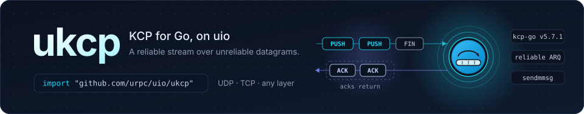

<p align="center">
  
</p>

<p align="center">
  <a href="https://pkg.go.dev/github.com/urpc/uio/ukcp"></a>
  <a href="https://github.com/urpc/uio/blob/main/LICENSE"></a>
</p>

**ukcp** is KCP for Go, built as a protocol layer on the
[uio](https://github.com/urpc/uio) event engine: a reliable, ordered byte
stream over an unreliable datagram transport. Every session runs in the
connection's own turns on a shared worker pool — no goroutine and no timer of
its own; its clock is the connection's turn timer. The protocol engine is the
battle-tested one from [xtaci/kcp-go](https://github.com/xtaci/kcp-go),
vendored file-for-file (see [License](#license)).

## Highlights

- **A stream over anything.** As a `uio.PacketLayer` it reads a packet
  connection's datagrams — UDP, IP, unixgram — one per turn, and hands the
  layers above a reliable stream. Above a stream connection it frames its own
  segments, so it composes in either direction with TLS and with itself.
- **Zero goroutines, zero timers.** The flush clock, retransmissions, window
  probes and the keepalive all run on the session's own turn timer — no
  goroutine of its own, no timer of its own. An idle session wakes only for
  the keepalive; turn `KeepAlive` off to stop even that.
- **TLS, composed not bundled.** There is no built-in TLS: KCP has no `wss://`
  of its own to match, so TLS is a layer above (or below) by your choice,
  through `uio.WithLayers`.
- **A real EOF.** `CloseWrite` queues an empty push behind the data: an ended
  stream reaches the peer in order and reliably, so `io.EOF` travels the stack
  and half-close works through TLS too.
- **Portable segments.** The wire is the KCP every implementation speaks
  (24-byte header, little-endian, `PUSH`/`ACK`/`WASK`/`WINS`); bulk send and
  receive batch into one `sendmmsg`/`recvmmsg` on Linux and answer a small read
  turn's output together, so the system-call side stays out of the way.
- **Bounded by design.** The windows, the buffered bytes, the MTU and the first
  segment's wait are all bounded and configurable, and a session reports itself
  — RTT, congestion, queue depth — through `uio.FindLayer`.

## Install

```go
import "github.com/urpc/uio/ukcp"
```

The package ships inside the [uio module](https://github.com/urpc/uio);
`go get github.com/urpc/uio` fetches it.

## Quick start

`ServerLayer` and `ClientLayer` return a `uio.Layer` (and a `uio.PacketLayer`),
installed on `uio.Events` through `uio.WithLayers`:

```go
package main

import (
	"log"

	"github.com/urpc/uio"
	"github.com/urpc/uio/ukcp"
)

func main() {
	ev := &uio.Events{
		Handler: uio.FuncHandler{
			Read: func(c uio.Conn) error { _, err := c.WriteTo(c); return err },
		},
	}
	log.Fatal(ev.Serve("udp://:9000", uio.WithLayers(ukcp.ServerLayer(ukcp.Options{}))))
}
```

The client half, dialing through `uio.WithLayers(ukcp.ClientLayer(...))`:

```go
conn, err := client.DialContext(ctx, "udp://example.org:9000",
	uio.WithLayers(ukcp.ClientLayer(ukcp.Options{})),
)
if err != nil {
	log.Fatal(err)
}
defer conn.Close()

_, _ = conn.Write([]byte("hello"))
```

A dial returns once the session exists; its stream reaches you through
`Events.Handler`'s `OnRead` (or through `uio.NewBlockingConn(conn)`), and the
returned `uio.Conn` is for writing, closing, deadlines and addressing. A client
needs no acknowledgement to open: the first segments retransmit until the peer
answers.

## How it works

1. **A session per peer.** On a UDP listener, every source address is one
   session; `ServerLayer` waits for the peer's first valid segment to name the
   conversation, and `ClientLayer` picks a random one at once. Every segment
   is acknowledged as it arrives; one that never does is retransmitted.
2. **Segments in, a stream out.** Input is decoded in the connection's turn —
   a datagram per turn on a packet connection, self-framed segments on a stream
   one — and the in-order bytes go up the stack as they become whole.
3. **A clock that is the turn's timer.** One timer per session, armed for the
   engine's next due: a flush, a retransmission, a window probe, the keepalive.
   Writes and read turns flush at once; the interval only paces background
   work.
4. **The end travels in order.** `CloseWrite` queues an empty push behind the
   data; the peer's engine delivers it after every byte before it, and the
   layer above reads `io.EOF`. A stream connection below that ends is EOF at a
   segment boundary and `io.ErrUnexpectedEOF` inside one.

## Configuration

`Options` (`LayerOptions`) holds the protocol parameters. The zero value is the
defaults — KCP's **Fast profile** — and `Options.Validate` reports up front
what a session would refuse.

| Field | Default | What it does |
| --- | --- | --- |
| `MTU` | 1400 | Largest segment, header included (24..1500). Must not exceed the Events' `ReadBufferSize` — on both ends, since the peer's segments arrive into this end's read buffer. |
| `SendWindow` / `RecvWindow` | 1024 | Windows in segments, each at most 65535 — the header's window field is a `uint16`. A window times the MTU bounds what a session holds, about 1.4 MiB each way. |
| `NoDelay` | off | The engine's low-latency RTO mode: a 30 ms floor instead of 100 ms. |
| `Interval` | 30 ms | The engine's flush cadence, 10 ms to 5 s. Data never waits for it. |
| `Resend` | 2 | Fast-retransmit threshold; a negative value turns fast retransmit off. |
| `CongestionControl` | off | Enables the engine's congestion window. Every KCP profile runs it off; flow control is the windows' and the timer's. |
| `DeadLink` | 20 | Retransmissions of one segment before the session ends with `ErrDeadLink`. |
| `HandshakeTimeout` | 10 s | How long a server waits for the peer's first segment. KCP has no handshake, but a peer that never speaks must not hold a connection for ever: it ends with `ErrPeerSilent`. A negative value waits without a bound; a client never waits. |
| `KeepAlive` | 10 s | An idle session probes the peer's window this often; silence for three periods ends it with `ErrKeepAliveTimeout`. A negative value disables keepalive. |
| `MaxBuffered` | 4 MiB | Bytes a session holds for the writer; a write past it returns `ErrOutboundOverflow`. |

Invalid combinations — an MTU past the engine's buffers, a window past 65535, an
interval outside 10 ms..5 s — fail the connection with `ErrInvalidOptions`.

**Backpressure.** A slow reader closes the receive window, the sender's queue
fills, and `Write` returns `ErrOutboundOverflow` rather than blocking; when the
reader catches up the queued data leaves by itself. `MaxBuffered` and the send
window bound what a session holds, `MaxOutboundBuffered` bounds the socket's
queue, and a peer that stops acknowledging is found out by the dead-link bound.

## Composing layers

`ServerLayer` and `ClientLayer` return a `uio.Layer` — and a `uio.PacketLayer`,
the marker a chain on a packet connection must start with, or the endpoint
refuses it with `uio.ErrLayersNeedStream` — for stacks of your own:

```go
// udp -> kcp -> tls: a TLS stream carried by KCP over UDP
listener, err := events.Listen("udp://:9000", uio.WithLayers(
	ukcp.ServerLayer(ukcp.LayerOptions{}), utls.ServerLayer(utls.LayerOptions{TLSConfig: tlsConfig}),
))
conn, err := client.DialContext(ctx, "udp://example.org:9000", uio.WithLayers(
	ukcp.ClientLayer(ukcp.LayerOptions{}), utls.ClientLayer(utls.LayerOptions{TLSConfig: tlsConfig}),
))
```

The same layers run above a stream — the segments frame themselves on the
connection's own length field — so `tcp -> kcp`, `tcp -> tls -> kcp` and KCP
above KCP all compose:

```go
// tcp -> kcp -> tls, and kcp -> kcp over UDP
uio.WithLayers(ukcp.ServerLayer(opts), utls.ServerLayer(utls.LayerOptions{TLSConfig: tlsConfig}))
uio.WithLayers(ukcp.ServerLayer(opts), ukcp.ServerLayer(opts))
```

A layered UDP listener refuses `DialPeer` with `uio.ErrUnsupported`: the peer's
connection belongs to the stack, which only the stack opens, and a socket-level
connection would bypass every layer.

## Session state

The session a connection carries reports itself through `uio.FindLayer`:

```go
state, ok := uio.FindLayer[interface{ State() ukcp.SessionState }](conn)
if ok {
	s := state.State()
	log.Printf("rtt %v, cwnd %d, queued %d, inflight %d", s.SRTT, s.CWnd, s.Queued, s.Inflight)
}
```

`State` may be read from any goroutine, including from an `OnBytesWritten`
observer inside a write; the snapshot is published, never taken under the
engine's lock.

## License

[Apache License 2.0](https://github.com/urpc/uio/blob/main/LICENSE).

The protocol engine under `internal/kcp` is
[xtaci/kcp-go v5.7.1](https://github.com/xtaci/kcp-go), MIT licensed
(`internal/kcp/LICENSE`), vendored with three patches marked `ukcp:` in
`kcp.go` — a stream-mode empty send as the end-of-stream marker, a test clock
hook, and a flush type that keeps an answer-only flush from moving the send
queue — described in `internal/kcp/README.md`.
