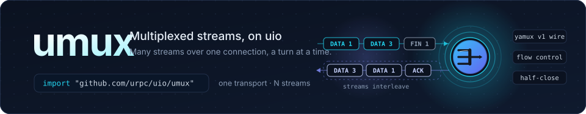

<p align="center">
  
</p>

<p align="center">
  <a href="https://pkg.go.dev/github.com/urpc/uio/umux"></a>
  <a href="https://github.com/urpc/uio/blob/main/LICENSE"></a>
</p>

**umux** multiplexes many bidirectional byte streams over one connection on
the [uio](https://github.com/urpc/uio) event engine. Every stream is a
`uio.Conn`: open one, write and half-close it like a TCP connection, and its
bytes interleave with every other stream's on the transport. The session runs
entirely in the transport's own turns — no goroutine and no timer per stream;
its timers ride the connection's single wake deadline.

The fine print is where the work went: per-stream flow control that a
half-consumed window cannot stall, a session receive budget that pauses
transport reads instead of growing memory, zero-copy arrival for whole frames,
and a FIN that settles only once the transport accepted it.

## Highlights

- **Streams are Connections.** `umux.Stream` implements `uio.Conn` — `Read`,
  `Write`, `Writev`, `WriteOwned`, `CloseWrite`, `CloseWith`, `State`,
  timers, `Wake` — so code written for a socket works on a stream, including
  `uio.Bridge`.
- **Zero goroutines, zero timers per stream.** Frames arrive in the
  transport's read turn and are dispatched there; a stream's timer and the
  keepalive share the transport's one wake deadline.
- **Flow control at both layers.** A per-stream window paces each sender (the
  peer's SYN/ACK announces its receive window; grants return consumed credit
  at a quarter of the smaller window), and `SessionWindow` bounds what the
  session buffers across all streams by pausing transport reads when it fills.
- **Zero-copy arrivals.** A data frame that lands whole in one transport read
  is handed to the handler in place; only a residual a callback leaves behind
  is copied before the transport reuses its buffer.
- **A FIN that means it.** `CloseWrite` queues the FIN behind accepted data,
  and the stream settles — and reports `OnClose` — only after the transport
  took the FIN and both directions drained. An abort stays an abort: `RST`
  travels through `CloseWith`, and a pairing whose partner is gone is reset,
  not left half-open.
- **Tunnels out of the box.** A relay is a `uio.Bridge` whose `Dial` opens a
  stream and `Pair`s it with the user connection; an agent bridges each
  accepted stream to a local service. See
  [examples/umux-tunnel](../examples/umux-tunnel).
- **The yamux v1 wire.** The 12-byte header, the SYN/ACK window deltas above
  the 256 KiB floor, the FIN on a `WindowUpdate` frame and the ping sequence
  in its length field follow hashicorp/yamux v1, so the wire interoperates
  with that implementation at default settings.

## Install

```go
import "github.com/urpc/uio/umux"
```

The package ships inside the [uio module](https://github.com/urpc/uio);
`go get github.com/urpc/uio` fetches it.

## Quick start

A multiplexed echo server — every stream reaches the handler as a `uio.Conn`:

```go
package main

import (
	"errors"
	"log"

	"github.com/urpc/uio"
	"github.com/urpc/uio/umux"
)

func main() {
	echo := uio.FuncHandler{Read: func(c uio.Conn) error {
		// What arrived goes straight back; a full outbound queue retries on
		// the next callback.
		if _, err := c.WriteTo(c); err != nil && !errors.Is(err, uio.ErrOutboundOverflow) {
			return err
		}
		return nil
	}}
	log.Fatal(umux.NewServer(umux.Config{Handler: echo}).Serve("tcp://:9000"))
}
```

A client dials the transport once and opens streams on it:

```go
seen := make(chan string, 1)
cli := umux.NewClient(umux.Config{Handler: uio.FuncHandler{Read: func(c uio.Conn) error {
	seen <- string(c.PeekChunk())
	_, err := c.Discard(-1)
	return err
}}})
sess, err := cli.Dial(context.Background(), "tcp://127.0.0.1:9000")
if err != nil {
	log.Fatal(err)
}
st, err := sess.Open(context.Background())
if err != nil {
	log.Fatal(err)
}
st.Write([]byte("hello"))
log.Println(<-seen) // hello
```

That is the whole loop: one transport carries any number of streams, and each
stream behaves like a TCP connection. Half-close (`st.CloseWrite()`), abort
(`st.CloseWith(err)`) and the write-side contract are under
[Rules of the road](#rules-of-the-road).

Without a `Handler`, a server hands sessions and streams over instead; they
close with their transport:

```go
go srv.Serve("tcp://:9000")
for sess := range srv.Sessions() {
	for in := range sess.Accept() {
		go serve(in.Stream) // in.Metadata carries the opener's SYN bytes
	}
}
```

## Stream metadata

`Session.OpenWith(ctx, meta)` attaches opaque bytes to the stream's SYN:

```go
st, err := sess.OpenWith(ctx, []byte("proxy=web dst=10.0.0.7:8080"))
```

The acceptor receives them once, at accept time, and the session keeps no
reference afterwards. A handler implements the `MetadataHandler` capability —
`OnMetadata(c uio.Conn, meta []byte)`, called just before `OnOpen` — and a
pulled stream carries them in its `Accepted` value (`in.Stream`,
`in.Metadata`). The slice is valid during `OnMetadata` and, in pull mode,
for as long as you keep the value; a caller that needs the bytes later copies
them.

umux never interprets them: they are the caller's own routing or
identification data (a proxy name, a destination, a trace id), binary-safe
and copied out of the transport buffer before delivery. `Config.MaxMetadata`
bounds their size (default 4 KiB); a larger `OpenWith` is refused locally with
`ErrMetadataTooLarge`, and a receiver with a smaller cap rejects the frame and
the session. A stream opened without metadata — plain `Open` — puts exactly
the same bytes on the wire as before.

## How it works

The transport connection is the session. Each read turn parses whole frames
from the transport's inbound buffer — borrowing a frame that lies contiguous in
it — demultiplexes by stream id, and runs that stream's callbacks
synchronously. Stream writes enqueue frames on the session, and one flush per
turn hands them to the transport in stream order, coalescing a turn's frames
into as few writes as the transport supports near-and-far.

Flow control runs at two scopes. Each stream carries a receive window — 256 KiB
by default — that the peer announced in its SYN or ACK; a receiver grants
consumed credit back when it passes a quarter of the smaller of the two
windows, so a sender whose own cap is small can never wait on a grant that the
larger window would have deferred for ever. Across streams, `SessionWindow`
bounds the decoded bytes buffered; past it the session stops reading its
transport, kernel buffers fill, and TCP slows the peer — memory stays bounded
without failing a frame.

A FIN is part of the queue: `CloseWrite` marks the stream and queues the FIN
behind whatever data was accepted; the stream settles when the transport
accepted the FIN and both directions drained. Aborts are immediate and
independent: `CloseWith(err)` queues an `RST`, and the peer sees
`ErrStreamReset` through `OnClose`.

Sessions close two ways. `Close(cause)` is immediate: GoAway, then the
transport goes, and every stream closes with the cause. `Shutdown(ctx)` is the
graceful path: it sends GoAway, refuses new streams — `Open` fails with
`ErrGoAway`, and a peer that races an open is reset at once instead of waiting
for its own open timeout — while the existing streams keep reading, writing
and half-closing normally. When the last stream ends on its own the transport
closes and `Shutdown` returns nil; when ctx ends first the survivors are reset
with `ErrShutdownTimeout` and `Shutdown` returns the context's error. It is
cooperative on purpose: umux cannot know when an application's byte stream is
complete, so a stream nobody ends is the shutdown context's to cut.

## Configuration

`Config` holds every setting; the zero value is the defaults.

| Field | Default | What it does |
| --- | --- | --- |
| `Handler` | none | Receives every stream's callbacks. When nil, sessions go to `Server.Sessions()` and streams to `Session.Accept()`. |
| `Observer` | none | Hears every stream's read/written bytes, plus window reopenings (`n == 0`). An observer that also implements `QueueDrainedObserver` hears each flush that emptied a stream's queue — what a relay needs to resume a source it paused. |
| `Accept` | none | Vets an inbound stream before it is accepted; a non-nil error refuses it with `RST`. |
| `ReadBufferSize` | 256 KiB | Transport socket read size. A data frame spans several reads otherwise, and every read costs a turn. |
| `WindowSize` | 256 KiB | Each stream's receive window (the protocol floor is 256 KiB). The send side starts from the peer's announced window, capped by this value. |
| `SessionWindow` | 4 MiB | Bytes buffered across all streams of one session; more pauses transport reads until consumption catches up. |
| `MaxStreams` | 1024 | Concurrent streams per session. |
| `MaxFrame` | 32 KiB | Largest data-frame payload (at most 64 KiB), outgoing frames only. |
| `MaxMetadata` | 4 KiB | Largest `OpenWith` metadata (at most 1 MiB); held only until it is handed over, and a larger SYN is rejected by the receiver. |
| `AcceptBacklog` | 256 | Accept-queue depth in pull mode; a full queue refuses the peer's stream. |
| `StreamOpenTimeout` | 75 s | How long an `Open` waits for its ACK. |
| `StreamCloseTimeout` | 5 m | How long a half-closed stream may stay before it is reset. |
| `KeepAlive` | 30 s | Ping interval (the sequence rides the frame's length field, as yamux does); a negative value disables it. |
| `KeepAliveMax` | 60 s | How long a ping may stay unanswered before the session ends with `ErrKeepAlive`. |
| `Executor` | none | Reserved: per-stream turn scheduling; nil keeps synchronous demultiplexing. |

## Rules of the road

- **Callbacks run on the transport's turn.** `OnOpen`, `OnRead`, `OnTimer`
  and `OnClose` for every stream arrive on the transport connection's turn,
  one stream at a time. Do not block there: the turn carries every stream.
- **OnClose never overlaps OnRead.** A `CloseWith` from another goroutine is
  queued and delivered on the turn; a stream's close is its last callback.
- **One reader.** `Read`, `Discard` and `WriteTo` may be called from any
  goroutine, with one reader per stream at a time. `Read` never blocks:
  `(0, nil)` means no bytes yet — the end is `State()&StatePeerEnded`, not a
  zero-length read probe.
- **Writes are non-blocking and safe from any goroutine.** A short write
  returns `(n, ErrOutboundOverflow)`; retry the remainder when the peer's
  window update wakes you. `WriteOwned` is whole or refused whole — only an
  overflow leaves the buffer with the caller.
- **Borrowed slices.** `PeekChunk`'s slice is valid for the current handler
  callback (or until a consuming call). `WriteTo` copies out of a borrowed
  transport frame before handing it to the writer, so its bytes stay put.
- **Socket-only methods** — deadlines, `SetLinger`, `Sendmsg` paths,
  `ReserveOutbound` — return `uio.ErrUnsupported` on a stream.

## Composing

A session's transport is an ordinary `uio` connection, so layers apply on the
dial: `Client.Dial(ctx, addr, uio.WithLayers(...))` runs umux over TLS, KCP,
or a tunnel stream. `Server.Serve` and `Listen` take the matching listen
options. Above, a stream is a `uio.Conn`, which is what lets `uio.Bridge`
carry a tunnel: a relay dials a stream per user connection and pairs them, an
agent bridges each stream to a local service —
[examples/umux-tunnel](../examples/umux-tunnel) is the complete shape as a
runnable relay and agent.

## Wire compatibility

The wire format is yamux v1's: the 12-byte header layout, the SYN/ACK window
deltas above the 256 KiB floor, the FIN on a `WindowUpdate` frame, and the
ping sequence in its length field. A session at default settings therefore
interoperates with [hashicorp/yamux](https://github.com/hashicorp/yamux)
flowing either way, and the frame layout needs no private extensions to carry
one. The implementation is independent: no yamux code is part of umux, and the
protocol's layout above is the only thing the two share.

One opt-in exception: a stream opened with `OpenWith` metadata announces
itself with frame type 4 — the umux SYN-metadata frame, outside yamux's type
space — carrying the usual window delta followed by the opener's opaque
bytes; its ACK stays a plain `WindowUpdate`. A yamux peer rejects that frame,
so metadata requires umux on both ends; a session that never uses `OpenWith`
never sends it.

## License

[Apache License 2.0](https://github.com/urpc/uio/blob/main/LICENSE).
