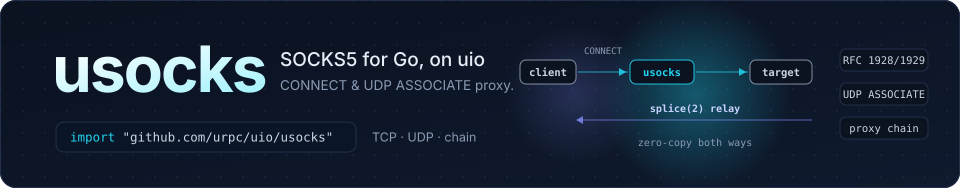

<p align="center">
  
</p>

<p align="center">
  <a href="https://pkg.go.dev/github.com/urpc/uio/usocks"></a>
  <a href="https://github.com/urpc/uio/blob/main/LICENSE"></a>
</p>

**usocks** is a SOCKS5 proxy (RFC 1928, RFC 1929) built as a `uio.Handler` on the
[uio](https://github.com/urpc/uio) event engine, relaying through
[ubridge](https://github.com/urpc/uio/tree/main/ubridge). The connection stays a
plain socket for its whole life: the handshake runs as an `OnRead` state machine,
and once it completes the server dials the target and relays. With no layer stack
mediating reads, a CONNECT relay uses native `splice(2)` — the zero-copy path a
plain tunnel uses. Nothing costs a goroutine per connection.

## Highlights

- **CONNECT and UDP ASSOCIATE.** TCP CONNECT relays a byte stream to the target;
  UDP ASSOCIATE allocates a datagram relay for the association, with RFC 1928 §7
  fragment reassembly. Both share the handshake, the governance hooks and the
  lifecycle.
- **Zero-copy relay.** A CONNECT's two legs are plain sockets, so ubridge relays
  them with `splice(2)` on Linux — no user-space copy on the data path. Half-close
  and aborts pass through end to end.
- **Zero goroutines per connection.** The handshake, the relay and the UDP
  association all run on the connection's own turns on a shared worker pool. The
  only goroutines are the shared UDP relay's idle sweep and a domain-target
  resolution.
- **Governance is pluggable.** `Authenticator`, `Policy` and `Limiter` are hooks
  you fill; usocks ships the seams and safe defaults (no-auth, allow-all,
  unlimited). Concrete credential stores, rule engines, rate limiters and
  hot-reload belong to your layer, not here.
- **Proxy chaining.** A `Dial` hook reaches the target through an upstream proxy
  (or any custom path); `DialSOCKS5` is a built-in SOCKS5 client for the common
  case. The adopted tunnel still relays with splice.
- **Bounded by design.** The handshake, the dial, the UDP idle and reassembly
  timers, the concurrent-dial and association caps are all bounded and
  configurable; a stalled client or a forgotten association is reclaimed.

## Install

```go
import "github.com/urpc/uio/usocks"
```

The package ships inside the [uio module](https://github.com/urpc/uio);
`go get github.com/urpc/uio` fetches it.

## Quick start

`NewServer` builds a proxy; `Serve` listens and runs it:

```go
package main

import (
	"log"

	"github.com/urpc/uio/usocks"
)

func main() {
	srv := usocks.NewServer(usocks.Options{})
	log.Fatal(srv.Serve("tcp://:1080"))
}
```

Point any SOCKS5 client at it:

```bash
curl --socks5-hostname 127.0.0.1:1080 https://example.com
```

The zero `Options` is a no-auth, allow-all, unlimited CONNECT + UDP ASSOCIATE
proxy with default timeouts. `Close` initiates shutdown and `Wait` blocks until
every relay has stopped.

## How it works

1. **A handshake in the read turns.** Each client connection negotiates a method
   (no-auth or RFC 1929 username/password), authenticates if required, and parses
   the request — all in `OnRead`, no goroutine of its own. A deadline bounds the
   whole handshake against a slow client.
2. **CONNECT: dial, answer, relay.** The server dials the target (directly, or
   through the `Dial` hook), writes the reply, and pairs the two legs with
   ubridge. From then on ubridge relays both ways with backpressure, half-close
   and `splice(2)`.
3. **UDP ASSOCIATE: a relay per association.** The server allocates a UDP relay
   socket, answers with its bound address, and keeps the TCP connection open as
   the association's control channel. Client datagrams carry a SOCKS UDP header;
   the relay strips it, forwards to the target, and frames the reply back.
   Fragments are reassembled; the association ends when the TCP channel closes or
   it goes idle.
4. **The source is locked.** A UDP association accepts datagrams only from the
   client address it first saw (or the address the request advertised); a foreign
   source is dropped.

## Configuration

`Options` holds the parameters; the zero value is the defaults.

| Field | Default | What it does |
| --- | --- | --- |
| `Authenticator` | nil | Verifies username/password credentials. nil offers no-auth only; set it to require authentication. |
| `Policy` | nil | Decides whether a request (or UDP target) may proceed; a non-nil error denies it. nil allows all. |
| `Limiter` | nil | Admits a request against quotas; returns a release func run when the connection closes. nil is unlimited. |
| `Dial` | nil | Custom dial returning an established connection to the target (e.g. through an upstream proxy); nil dials directly. |
| `HandshakeTimeout` | 10 s | Bounds the whole SOCKS handshake (Slowloris defense). |
| `DialTimeout` | 10 s | Bounds the target dial. |
| `MaxConcurrentDials` | 0 | Caps in-flight target dials; 0 is unlimited. A dial past the cap is refused. Set this in production — see below. |
| `InboundLimit` | ubridge default | The relay's backpressure watermark. |
| `UDPIdleTimeout` | 60 s | Closes a UDP association idle this long. |
| `UDPReassemblyTimeout` | 5 s | Abandons an incomplete UDP fragment sequence (RFC 1928 minimum is 5 s). |
| `MaxUDPAssociations` | 0 | Caps live UDP associations; 0 is unlimited. |

> **Production note.** A target dial runs synchronously on the connection's
> worker, bounded by `DialTimeout`. With `MaxConcurrentDials` left at 0
> (unlimited), many simultaneous dials to slow or blackholed targets can occupy
> every worker and stall the proxy. Set `MaxConcurrentDials` to a bound suited to
> your worker count, and keep `DialTimeout` short. The cap is a hook-sized knob,
> not a rate-limit engine — per-user/per-IP quotas belong in your `Limiter`.

## Governance hooks

The hooks run on the connection's turn, so they must return promptly; a slow
external backend belongs behind an async wrapper you provide.

```go
srv := usocks.NewServer(usocks.Options{
	Authenticator: myAuth,   // Authenticate(ctx, username, password) error
	Policy:        myPolicy, // Allow(ctx, *Request) error
	Limiter:       myLimit,  // Admit(ctx, *Request) (release func(), err error)
})
```

`Request` carries the command, target host/port, the client address and the
authenticated username, so a policy can decide on any of them. A denied request
is answered with the SOCKS "connection not allowed" reply. Compare credentials in
constant time inside your `Authenticator`.

## Proxy chaining

The `Dial` hook reaches the target through an upstream proxy; the server adopts
the established tunnel into its own Events and relays it (still with splice).
`DialSOCKS5` is a built-in SOCKS5 client for the common case:

```go
srv := usocks.NewServer(usocks.Options{
	Dial: func(ctx context.Context, target string) (net.Conn, error) {
		return usocks.DialSOCKS5(ctx, "upstream:1080", target, nil)
	},
})
```

`DialSOCKS5` performs the client handshake — method negotiation, optional
username/password (`*SOCKS5Auth`), CONNECT — over a plain `net.Conn` bounded by
ctx, and returns the tunnel. The hook is general: an HTTP upstream, a per-target
choice of upstream, or a multi-level chain all fit the same signature.

## UDP ASSOCIATE

A UDP ASSOCIATE request allocates a relay and answers with its bound address; the
TCP connection stays open as the control channel. Each client datagram carries the
SOCKS UDP header (RSV, FRAG, ATYP, DST.ADDR, DST.PORT, DATA); the relay forwards
the payload to the target and frames the reply back with the target's address.
One association can reach many targets. Fragments (FRAG ≠ 0) are reassembled per
RFC 1928 §7 — a sequence is abandoned on timeout or a position regression, and a
reassembled datagram past the UDP maximum is dropped.

This makes UDP-based protocols reachable through the proxy — DNS over UDP, and
QUIC/HTTP3 for clients that implement SOCKS5 UDP ASSOCIATE.

**Security boundaries.** The relay validates datagram sources, which hardens it
against injection and hijack but bounds what it can relay:

- A reply is accepted only from a target the client actually contacted, matched
  by exact address **and port**. Protocols whose reply comes from a different
  source port than the request's destination (TFTP, some RTP/SIP flows) are not
  relayed — this is the price of blocking forged-reply injection.
- The client is pinned to the TCP control peer's IP (and the request's advertised
  address when it gives a specific IP and port; a port of 0 means "unknown").
  An attacker on the same IP can still race the first datagram of an unlocked
  association; the pin narrows the exposure from any source to the same IP.
- The reply whitelist holds up to 4096 targets per association and resets when
  full; domain-target resolution shares a budget of 64 concurrent lookups across
  associations. Both bound memory and goroutines; a single very busy association
  can exhaust its own whitelist or the shared resolver budget.

## License

[Apache License 2.0](https://github.com/urpc/uio/blob/main/LICENSE).