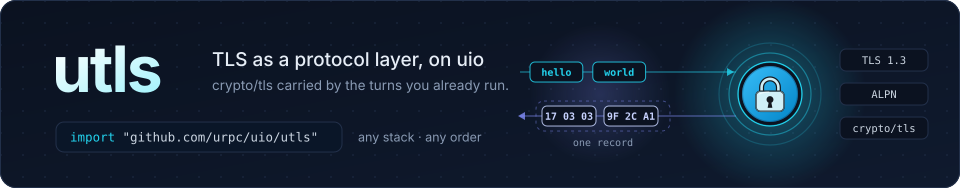

<p align="center">
  
</p>

<p align="center">
  <a href="https://pkg.go.dev/github.com/urpc/uio/utls"></a>
  <a href="https://github.com/urpc/uio/blob/main/LICENSE"></a>
</p>

**utls** runs TLS as a protocol layer on the [uio](https://github.com/urpc/uio)
event engine, with `crypto/tls` doing the cryptography. Install it in a
connection's layer chain and everything above it — your handler, another
protocol, another layer — reads and writes plaintext without knowing TLS is
there. Nothing costs a goroutine: the handshake runs as a coroutine the
connection's own read turns carry, and records are decrypted straight from
the bytes those turns read.

## Highlights

- **A layer, not a listener.** `Server` and `Client` build a `uio.Layer` for
  `uio.WithLayers`. Put it under a handler, under `uws` (that is how wss
  runs), over KCP, or between two tunnel layers — the stack decides what is
  encrypted, not the endpoint.
- **Zero goroutines, zero timers.** `crypto/tls` asks its transport for
  bytes; when the round carried fewer, the transport hands control back and
  the next round resumes the handshake where it left off. The layer's own
  timer bounds the handshake; an idle connection arms nothing.
- **crypto/tls, unchanged.** `utls.Config` is `crypto/tls.Config` — ALPN,
  client certificates, session tickets, `GetCertificate`, everything it
  accepts works here, and a config written for `crypto/tls` needs no
  conversion. What was negotiated is read back as `crypto/tls`'s own
  `ConnectionState`.
- **The end travels as TLS defines it.** `Close` sends `close_notify` once
  what was accepted has left; `CloseWrite` sends it one way and shuts the
  connection below's writing half behind it, so a peer's reads end while
  yours go on.
- **Bounded by design.** The handshake has a deadline, and the decrypted
  bytes held for the handler above have a bound that pauses reads rather
  than growing memory.

## Install

```go
import "github.com/urpc/uio/utls"
```

The package ships inside the [uio module](https://github.com/urpc/uio);
`go get github.com/urpc/uio` fetches it.

## Quick start

A TLS echo server over TCP — the handler reads and writes plaintext:

```go
package main

import (
	"crypto/tls"
	"log"

	"github.com/urpc/uio"
	"github.com/urpc/uio/utls"
)

func main() {
	cert, err := tls.LoadX509KeyPair("server.pem", "server-key.pem")
	if err != nil {
		log.Fatal(err)
	}
	events := &uio.Events{Handler: uio.FuncHandler{
		Read: func(c uio.Conn) error {
			_, err := c.WriteTo(c) // plaintext: utls encrypts below it
			return err
		},
	}}
	started := make(chan struct{})
	events.Hooks = uio.FuncHandler{Start: func(*uio.Events) { close(started) }}
	go func() {
		if err := events.Serve(); err != nil {
			log.Fatal(err)
		}
	}()
	<-started

	listener, err := events.Listen("tcp://:8443", uio.WithLayers(
		utls.Server(&tls.Config{Certificates: []tls.Certificate{cert}}),
	))
	if err != nil {
		log.Fatal(err)
	}
	defer listener.Close()
	log.Fatal(events.Wait())
}
```

The client half dials through the same kind of chain; the `Conn` it gets
back is the top layer's, for writing, closing and addressing, and the
Handler above reads what arrived:

```go
client := &uio.Events{Handler: uio.FuncHandler{
	Read: func(c uio.Conn) error {
		chunk := c.PeekChunk()
		log.Printf("from the peer: %q", chunk)
		_, err := c.Discard(len(chunk))
		return err
	},
}}
go client.Serve()
defer client.Close(nil)

ctx, cancel := context.WithTimeout(context.Background(), 10*time.Second)
defer cancel()
conn, err := client.DialContext(ctx, "tcp://example.org:8443", uio.WithLayers(
	utls.Client(&tls.Config{ServerName: "example.org"}),
))
if err != nil {
	log.Fatal(err) // a handshake that failed or timed out reports its cause here
}
defer conn.Close()

_, _ = conn.Write([]byte("hello")) // plaintext on this side of the stack
```

`Listen` takes the `Events` once it serves; the `Hooks.Start` above is how a
program waits for that without guessing. `DialContext` returns once the whole
stack opened — the TLS handshake included — within the layer's deadline.

## How it works

1. **A layer between the socket and yours.** `Server` and `Client` install
   `crypto/tls` at their place in the chain: bytes arriving from below are
   the ciphertext, bytes written above are the plaintext, and the connection
   your handler holds is the layer's own — encrypted underneath, plaintext to
   it.
2. **The handshake is a coroutine.** `crypto/tls` reads and writes its
   transport as usual; that transport is the connection below, and when it
   has fewer bytes than the handshake asked for, the coroutine suspends and
   the turn ends. The next turn with bytes resumes it where it stopped — the
   rounds a connection already runs carry the handshake between them, so no
   goroutine and no timer of the layer are needed. A custom `Events.Executor`
   must not lock its workers to OS threads, since the coroutine may resume on
   another one.
3. **Records are decrypted in the turn.** After the handshake, each read turn
   decrypts straight out of what it read: a record that arrived whole crosses
   no copy, and one split across several reads stays cut in `crypto/tls`'s
   buffer until it is whole.
4. **The end follows the protocol.** Whatever is above sees a stream: data
   arrives in order, and the peer's `close_notify` delivers what came with it
   and then the close. `Close` sends this end's `close_notify` after what was
   accepted has left the wire; `CloseWrite` sends it one way and half-closes
   the connection below.

## Configuration

`Config` is `crypto/tls`'s, unchanged. The layer itself has two knobs:

| Option | Default | What it does |
| --- | --- | --- |
| `HandshakeTimeout(d)` | 10 s | Bounds the handshake; its expiry closes the connection. A negative value waits without a bound. |
| `StagingBound(n)` | 64 KiB | Decrypted bytes the layer holds for the handler above: at the bound it stops taking chunks from below, so a stalled reader stills the wire. A chunk in hand is decrypted whole, so a delivery may pass the bound by that record (up to 16 KiB) and the turn's read; the framework's own delivery bound (64 KiB, or `Events.MaxInboundBuffered`) caps it as well. |

```go
utls.Server(cfg, utls.HandshakeTimeout(5*time.Second), utls.StagingBound(32<<10))
```

**Size the transport's reads to the record.** A TLS record carries up to
16 KiB, and a socket read smaller than that splits one record across several
rounds. On uio that is `uio.Events.MaxBufferSize`, whose default of 4 KiB
turns one record into four reads; set it to at least 16 KiB — bulk transfers
speed up measurably from it, and 64 KiB measured fastest on the hosts we ran.

Everything else — certificates, `ClientAuth`, `NextProtos`, ticket keys — is
`crypto/tls`'s configuration, applied exactly as `crypto/tls` applies it.

## Connection state

What the handshake settled on is `crypto/tls`'s own `ConnectionState`, read
off the connection from any goroutine:

```go
state, ok := uio.FindLayer[interface{ State() utls.ConnectionState }](conn)
if ok {
	s := state.State()
	log.Printf("TLS %x, cipher %s, ALPN %q", s.Version, s.CipherSuite, s.NegotiatedProtocol)
}
```

Before the handshake settles it reports the zero state; after, the version,
cipher suite, ALPN, peer certificates and the rest are `crypto/tls`'s
answers. `uio.FindLayer` searches from the layer that built the connection
down to the socket, so in a stack that carries more than one TLS layer it
finds the outermost; `uio.LayerOf` names the single layer that built the
connection.

## Composing

TLS is one layer among others; the chain decides what rides on what:

```go
// wss: the WebSocket protocol above TLS (uws does this for you when its
// Options carry a TLSConfig)
uio.WithLayers(utls.Server(cfg), uws.ServerLayer(uws.LayerOptions{}))

// A TLS stream carried by KCP over UDP, and KCP's segments riding inside
// TLS over TCP — the same two layers, opposite orders
uio.WithLayers(ukcp.ServerLayer(ukcp.Options{}), utls.Server(cfg))
uio.WithLayers(utls.Server(cfg), ukcp.ServerLayer(ukcp.Options{}))
```

A TLS layer needs a stream below it: on a packet connection — UDP, IP,
unixgram — put a [PacketLayer](https://pkg.go.dev/github.com/urpc/uio#PacketLayer)
under it first, as `ukcp` is; a chain that starts with anything else is
refused with `uio.ErrLayersNeedStream`.

**Session tickets are the Config's**, as they are for `crypto/tls`: servers
sharing one `Config` resume one another's sessions, and servers each building
their own do not — the client falls back to a full handshake, which is slower,
not an error. Share one `Config` across every `Events` a process serves
through, and install the same ticket keys with
[`tls.Config.SetSessionTicketKeys`](https://pkg.go.dev/crypto/tls#Config.SetSessionTicketKeys)
on every process that shares an address.

## Rules of the road

- **What is above is plaintext.** The `Conn` above the layer reads and writes
  decrypted bytes; whatever protocol runs there needs no TLS of its own.
  Never install two TLS layers expecting them to split one connection — each
  is its own end-to-end exchange.
- **Opened means negotiated.** A connection above the layer opens only once
  its handshake settled; one whose handshake failed or timed out ends without
  Handler callbacks — no `OnOpen`, no `OnClose` — and a dial reports the cause
  from `DialContext`.
- **Close sends the notice; Close is a grace.** `Close` sends `close_notify`
  after what was accepted has left; `CloseWrite` sends it one way and
  half-closes the connection below — a stack below that cannot end one
  direction reports `uio.ErrUnsupported` after the notice went.
- **The peer's notice ends reads.** A peer's `close_notify` delivers what
  arrived with it and then closes, as a TLS peer's end does.
- **One behavior is pinned, not promised.** The handshake's coroutine relies
  on `crypto/tls` keeping a partial record across a temporary `net.Error`
  from its transport; the tests pin it, so a Go release that changes it fails
  here rather than in the field.

There is no built-in listener or dialer in this package: TLS is one layer in
a stack you configure, and a plain `uio.Events`' `Listen`/`DialContext` take
it through `WithLayers`.

## License

[Apache License 2.0](https://github.com/urpc/uio/blob/main/LICENSE).

The cryptography is Go's own [`crypto/tls`](https://pkg.go.dev/crypto/tls);
this package adds the layer that carries it on a uio connection.
