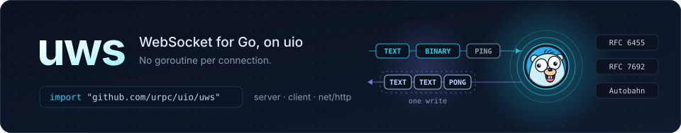
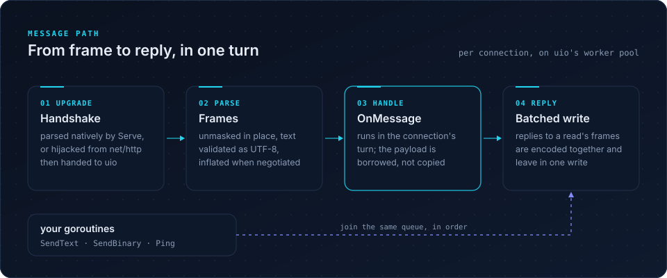

<p align="center">
  
</p>

<p align="center">
  <a href="https://pkg.go.dev/github.com/urpc/uio/uws"></a>
  <a href="autobahn/README.md"></a>
  <a href="https://github.com/urpc/uio/blob/main/LICENSE"></a>
</p>

**uws** is a WebSocket server and client for Go, built on the
[uio](https://github.com/urpc/uio) event engine. The handshake, frame parsing
and your handler all run in the connection's own turn on a shared worker pool,
so a connection costs no goroutine of its own, and a message that arrives in one
frame reaches you straight from the read buffer.

## Highlights

- **Standards first.** RFC 6455 framing and close handshake, RFC 7692
  permessage-deflate, and a clean run of the
  [Autobahn test suite](autobahn/README.md).
- **Three ways in.** A native server that parses the upgrade itself, an
  `http.Handler` for existing `net/http` servers, and a client.
- **Zero-copy reads.** Frames are unmasked in place, and an unfragmented,
  uncompressed message is handed to `OnMessage` straight from the read buffer.
- **Send from anywhere.** `SendText`, `SendBinary`, `Send` and `Ping` are safe
  from any goroutine and keep their order; they never block on the socket.
- **Batched replies.** Small replies to the frames of one read are encoded
  together and handed to the socket as one write.
- **Bounded by design.** Limits on frame and message size; replies are paced
  by watermarks that pause the connection's reads instead of growing memory,
  and an optional hard limit refuses any send past it; handshake and close
  time are bounded, and heartbeats work on both ends.

## Install

```go
import "github.com/urpc/uio/uws"
```

The package ships inside the [uio module](https://github.com/urpc/uio);
`go get github.com/urpc/uio` fetches it.

## Quick start

```go
package main

import (
	"log"

	"github.com/urpc/uio/uws"
)

type echo struct{}

func (echo) OnOpen(*uws.Conn)                  {}
func (echo) OnClose(*uws.Conn, uws.CloseEvent) {}

func (echo) OnMessage(c *uws.Conn, m uws.Message) {
	if m.Type == uws.TextMessage {
		_ = c.SendText(m.Text())
	} else {
		_ = c.SendBinary(m.Bytes())
	}
}

func main() {
	server := uws.NewServer(uws.Options{Handler: echo{}, EnableCompression: true})
	log.Fatal(server.Serve(":8080"))
}
```

`Serve` takes any number of addresses and returns once every connection has
finished.

## How it works

<p align="center">
  
</p>

1. **Upgrade.** `Serve` parses the HTTP upgrade natively; behind `net/http`
   the request is hijacked and the socket moved onto uio.
2. **Parse.** Frames are unmasked in place. Text is validated as UTF-8, with a
   SIMD validator on amd64 with AVX2, and compressed messages are inflated.
3. **Handle.** `OnMessage` runs in the connection's turn. The `Handler`
   callbacks of one connection are ordered and never overlap.
4. **Reply.** What the handler sends is queued; small replies to one read's
   frames are batched into one write. Sends from other goroutines join the same
   queue in order. When a peer stops reading and the queue reaches the high
   watermark, the connection stops reading its socket until the queue drains.

## Behind `net/http`

`Server` is also an `http.Handler`. Start its event loops with `Serve()` (no
address), then mount it like any other handler:

```go
server := uws.NewServer(uws.Options{Handler: echo{}})
go func() { log.Fatal(server.Serve()) }()

http.Handle("/ws", server)
log.Fatal(http.ListenAndServe(":8080", nil))
```

The handler takes over plain HTTP/1.1 connections. TLS and HTTP/2 connections
cannot be moved onto uio's event loops: terminate TLS in a proxy in front, or
let `Serve` take wss itself with `TLSConfig`.
A request that arrives before `Serve` has started gets HTTP 500; `Server.Ready`
closes a channel once the transport is up, so anything that mounts the handler
programmatically — a proxy that builds it at start-up — can wait on it first.

## Client

The callback form above suits one handler serving many connections. For a
single connection used from one place, the pull form returns a ready client
after the handshake:

```go
client, err := uws.Dial(ctx, "ws://127.0.0.1:8080/")
if err != nil {
	log.Fatal(err)
}
defer client.Close(1000, "")

_ = client.SendText("hello")
for {
	message, err := client.ReadMessage(ctx)
	if err != nil {
		break // a *uws.CloseError once the queued messages ran out
	}
	log.Printf("%s", message.Payload)
}
```

`uws.Dial` uses `uws.DefaultDialer`, a default-options dialer that lives as
long as the process. `Dialer.DialClient` is the same with a configured
dialer, whose `Options.Handler` must be nil because the client owns the
callbacks. A full message queue pauses the connection's reads — TCP flow
control then slows the peer — so a client must either keep reading or be
closed; `Client.Close` works either way. No message is dropped while the
connection is open; one that arrives once this end has begun closing and finds
the queue full is dropped rather than holding the close up. With a heartbeat
configured, a client nobody reads keeps pinging and is closed once a Ping goes
unanswered, its Pong stuck behind the unread messages. `ReadMessage` reports a
`*uws.CloseError` after the connection ended and every message received
before that was returned.

The callback form, for one handler serving every connection a dialer makes:

```go
type client struct{}

func (client) OnOpen(c *uws.Conn)                  { _ = c.SendText("hello") }
func (client) OnMessage(c *uws.Conn, m uws.Message) { log.Printf("%s", m.Payload) }
func (client) OnClose(c *uws.Conn, e uws.CloseEvent) {
	if e.Err != nil {
		log.Println("closed:", e.Err)
	}
}

dialer := uws.NewDialer(uws.Options{Handler: client{}})
if err := dialer.Dial(ctx, "ws://127.0.0.1:8080/", nil); err != nil {
	log.Fatal(err)
}
```

`Dial` returns once the upgrade request is sent and the handshake finishes in
the background; the connection reaches the application only through the
handler. Its third argument is the connection's userdata, available as
`Conn.Userdata` in every callback, so one stateless handler serves every dial.
An error from `Dial` means no connection was made and no callback follows,
`uio.ErrFirstTurnRefused` when a custom `Executor` declines the connection's
first turn. After a nil error, `OnOpen` means the connection is ready, and
`OnClose` always follows, with the cause in `CloseEvent.Err`; a failed
handshake calls it without `OnOpen`. The context bounds the dial and the
handshake, not the connection after it.

## Configuration

`Options` holds every setting; `Server` and `Dialer` embed the same type and
the zero value means the defaults, so the two ends cannot drift apart. Options
are read when `Serve` or `Dial` first starts the transport and never again.

| Field | Default | What it does |
| --- | --- | --- |
| `Subprotocols` | none | Protocols to negotiate; a server prefers the order given. |
| `MaxHeaderBytes` | 32 KiB | Upgrade headers this end reads: the request on a server's native `Serve` path, the response on a dialer. Behind `net/http`, `http.Server.MaxHeaderBytes` applies instead. |
| `MaxFramePayload` | 16 MiB | Largest frame read; larger outgoing messages are fragmented. |
| `MaxMessageSize` | 64 MiB | Largest message, after decompression. |
| `EnableCompression` | off | Negotiates permessage-deflate. |
| `CompressionLevel` | default | flate level 1-9 when compression is on; there is no level 0. |
| `KeepCompressionContext` | off | Keeps this end's compression history between messages; off starts every message fresh and asks the same of the peer. |
| `DisableUTF8Check` | off | Skips text validation for trusted peers. Not RFC compliant. |
| `HandshakeTimeout` | 10 s | Bounds the HTTP upgrade. |
| `CloseTimeout` | 5 s | Bounds the close handshake. |
| `HeartbeatInterval` | off | Pings the peer at this interval; servers and dialers alike. |
| `HeartbeatTimeout` | 2 × interval | Closes the connection when a ping gets no pong in time. |
| `Pollers` | uio default | Event loops. |
| `ReadBufferSize` | 4 KiB | Bytes per socket read; it also sizes the write batch blocks (clamped to 4-64 KiB). Over TLS a record carries up to 16 KiB: a read smaller than that splits one record across several rounds, so a wss server moving bulk data reads about twice as fast with 16 KiB and half again with 64 KiB. |
| `WriteCoalesce` | 4 KiB | Writes smaller than this join the connection's outbound batch instead of taking a send of their own; a negative value turns size-based buffering off. |
| `ReusePort` | off | Sets `SO_REUSEPORT` on listeners. |
| `Executor` | uio default | Runs connection and write turns on the native backend; the `stdio` backend does not use it. |
| `OutboundHighWatermark` | 64 KiB | Queued output at which a connection stops reading, so TCP flow control slows its peer instead of the replies piling up. A negative value disables the pause. |
| `OutboundLowWatermark` | High/4 | Queued output at or below which a paused connection reads again. |
| `MaxOutboundBuffered` | off | Hard limit on one connection's queued output from any sender: a send past it returns `ErrBackpressure` and queues nothing. Size it to fit the largest message you send. |

A `Server` adds `CheckOrigin` and `Authorize`, and a `Dialer` adds `Header`
and `RequestHeader` (see [Authentication](#authentication)). The `Handler`
lives in `Options`, shared by every connection a server accepts or a dialer
dials, with per-dial state passed as `Dial`'s userdata. The underlying transport is built from these
options and is not otherwise exposed; `Executor` is the scheduling escape
hatch. Invalid combinations, such as a low watermark not below the high
one, a high watermark above `MaxOutboundBuffered`, or a compression level
outside 1-9, make `Serve` and `Dial` return `ErrInvalidOptions`.

**Backpressure.** The watermarks pace what a connection's own reads produce
while its peer is slow. A connection whose queue reaches the high watermark
stops consuming; the bytes pile up in the transport's inbound buffer until it
stops reading the socket, and the peer's TCP window closes. Draining to the
low watermark resumes reads; no message is dropped. `Server.Stats` and
`Dialer.Stats` count the pauses and resumes.

Output that does not come from the connection's reads — a broadcast, a
subscription push, any send from another goroutine — is not paced by the
pause. Set `MaxOutboundBuffered` to bound it: past the limit `SendText`,
`SendBinary` and `Ping` return `ErrBackpressure`, and the caller decides to
drop, retry later or close.

**Traffic metrics.** A `Handler` that also implements `TrafficObserver` sees
transport bytes in both directions. Both callbacks are observation only: do
not call anything that sends or closes on the connection from them, and do not
block. A report is the result of I/O that just happened, and a send from it
feeds the report it answers; `OnOutbound` can also run while the write lock a
send holds is held, so a send there deadlocks the connection. `OnInbound` runs
in the connection's turn like the other callbacks; `OnOutbound` runs wherever
a send completes and may overlap them, so keep what it touches safe for
concurrent use:

```go
func (m metrics) OnInbound(c *uws.Conn, n int)  { m.read.Add(n) }
func (m metrics) OnOutbound(c *uws.Conn, n int) { m.written.Add(n) }
```

## Authentication

The upgrade request can carry credentials, and the server can refuse it before
the WebSocket exists, so a rejected client costs no handshake and no callback:

```go
dialer := &uws.Dialer{
	Header: http.Header{"Authorization": {"Bearer " + token}},
}

server := uws.NewServer(uws.Options{Handler: app{}})
server.Authorize = func(r *http.Request) (any, error) {
	user, err := verify(r.Header.Get("Authorization"))
	if err != nil {
		return nil, &uws.RejectError{Status: http.StatusUnauthorized, Reason: "bad token"}
	}
	return user, nil // the connection's Userdata from OnOpen on
}
```

`Dialer.Header` goes with every dial; `Dialer.RequestHeader(userdata)` adds
per-dial headers on top. Headers the handshake sets itself are refused with
`ErrInvalidOptions`: Host, Upgrade, Connection, Content-Length,
Transfer-Encoding, Expect, and `Sec-WebSocket-Key`, `-Version`, `-Protocol`,
`-Extensions` and `-Accept`.
`Authorize` runs after the request passed validation and `CheckOrigin`, on the
native path and behind `net/http` alike. A `*RejectError` answers with its
status, header and reason; any other error with 403. The answer is sent before
the connection closes, and the client gets it as a `*HandshakeError` — in
`CloseEvent.Err`, or from `DialClient` through `errors.As` — carrying the
status, the header and the reason. Without TLS the credentials travel in clear
text: serve wss with `TLSConfig`, whose state `Authorize` sees on `r.TLS` —
the server name asked for, a client certificate.

## Secure WebSockets (wss)

`Options.TLSConfig` makes a server a wss one and lets a dialer speak
`wss://` — a `crypto/tls` configuration, run by [`uio/utls`](../utls) under
the WebSocket protocol:

```go
server := uws.NewServer(uws.Options{
	Handler:   handler,
	TLSConfig: &tls.Config{Certificates: certs},
})

dialer := uws.NewDialer(uws.Options{
	Handler:   handler,
	TLSConfig: &tls.Config{}, // system roots; each dial verifies its URL's host
})
err := dialer.Dial(ctx, "wss://example.org:443/socket", nil)
```

A dialer with a `TLSConfig` still dials `ws://` in the clear; without one it
refuses `wss://`. The TLS handshake runs before the WebSocket one, within
`HandshakeTimeout`: one that fails fails the dial with its cause, and the
Handler hears nothing of the connection. Behind `net/http`, `ServeHTTP` runs
no TLS of its own and refuses a request that arrived over TLS: terminate TLS
elsewhere and pass the plain HTTP/1.1 upgrade through, or let `Serve` take
`wss://` itself with a `TLSConfig`. A
TLS record carries up to 16 KiB, so a `ReadBufferSize` of 16 KiB or more reads
one record per syscall.

## As a protocol layer

`ServerLayer` and `ClientLayer` run the WebSocket protocol as a `uio.Layer`,
for stacks of your own — TLS, an obfuscation, a tunnel, in any order, on an
`uio.Events` you configure:

```go
listener, err := server.Listen(addr, uio.WithLayers(
	utls.Server(tlsConfig), uws.ServerLayer(uws.LayerOptions{Authorize: checkToken}), tunnel,
))
conn, err := client.DialContext(ctx, "tcp://example.org:443", uio.WithLayers(
	utls.Client(tlsConfig), uws.ClientLayer("wss://example.org/tunnel", uws.LayerOptions{}), tunnel,
))
```

The layer carries a byte stream: what the layer above writes leaves as
Binary messages, and each message that arrives is handed up once whole,
message boundaries dropped. It answers Pings, runs the heartbeat, answers a
peer's Close, and sends one as the connection closes from above; a dial
returns once the handshake succeeded, and reports a refusal as a
`*HandshakeError`. The protocol's settings are `Options`' own; the
transport's — `Handler`, `Pollers`, `ReusePort`, `Executor`, `TLSConfig`,
`MaxOutboundBuffered` — belong to the Events, and options that name them fail
every connection with `ErrInvalidOptions` (`LayerOptions.Validate` reports it
up front). For messages, keep to `Server` and `Dialer`.

## Rules of the road

- **Payloads are borrowed.** `Message.Payload` is valid until `OnMessage`
  returns. Call `Message.Clone` to keep it or hand it to another goroutine.
  `Message.Text` and `Message.Bytes` hand the payload back to `SendText` and
  `SendBinary` without copying, for echoes.
- **Accepted is not delivered.** A nil error from `SendText`, `SendBinary` or
  `Ping` means the message was queued in order, not that the peer has it.
  Replies to a peer that stops reading pause this connection's reads; sends
  from elsewhere are bounded only by `MaxOutboundBuffered`, past which they
  return `ErrBackpressure`.
- **State without locks.** The `Handler` callbacks of one connection never
  overlap, so state kept with `SetUserdata` needs no locking from them;
  `TrafficObserver.OnOutbound` is the exception, and it must only observe —
  never send, close or block.
- **Closing.** `Conn.Close(code, reason)` queues its close frame after
  everything already accepted and returns; the connection then completes the
  handshake with the peer, which `CloseTimeout` bounds. Protocol
  errors close with 1002, invalid UTF-8 with 1007, oversized messages with
  1009.
- **Lifecycle.** `Server.Close` and `Dialer.Close` request shutdown and return
  at once, so they are safe inside callbacks. A server or dialer cannot be
  restarted.

The [API reference](https://pkg.go.dev/github.com/urpc/uio/uws) documents every
type and method.

## License

[Apache License 2.0](https://github.com/urpc/uio/blob/main/LICENSE)

The Go gopher in the banner is based on the original design by
[Renée French](https://reneefrench.blogspot.com/), licensed under
[CC BY 4.0](https://creativecommons.org/licenses/by/4.0/).
